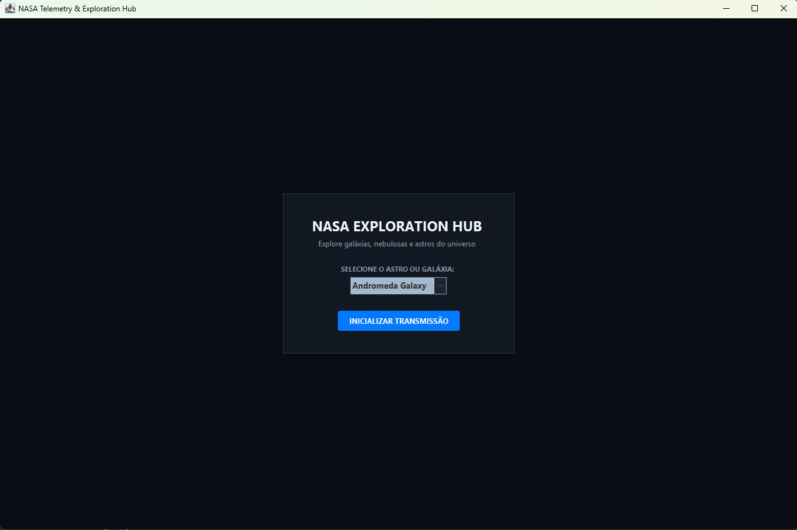
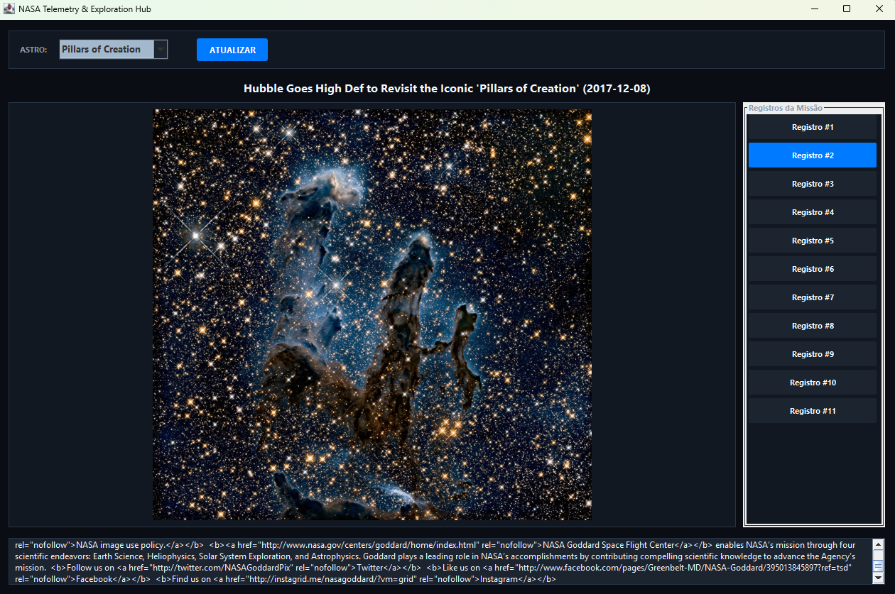

# NASA Telemetry & Exploration Hub

Aplicação desktop desenvolvida em Java (Swing) para consumo da API REST pública da NASA (*NASA Image and Video Library*), permitindo a exploração visual de galáxias, nebulosas e astros do universo em alta resolução.

## Funcionalidades

* **Módulo de Galáxias e Astros:** Consulta a biblioteca oficial de imagens da NASA com termos validados, retornando registros visuais detalhados.
* **Navegação por Miniaturas:** Exibe uma barra lateral com miniaturas clicáveis para alternar rapidamente entre os resultados da busca.
* **Visualizador Ampliado:** Modal de alta resolução para examinar as imagens detalhadamente.
* **Processamento Assíncrono:** Utiliza `SwingWorker` para realizar requisições de rede em segundo plano, evitando o travamento da interface gráfica.

## 🛠️ Tecnologias Utilizadas

* **Java 17** (Programação Orientada a Objetos)
* **Java Swing** (Interface Gráfica de Usuário - GUI)
* **Java HttpClient** (Requisições HTTP REST nativas)
* **Google Gson** (Processamento e serialização de respostas JSON)
* **Maven** (Gerenciamento de dependências e build)

## ⚙️ Como Executar o Projeto

### Pré-requisitos

* **Java JDK 17** (ou superior) instalado.
* **Maven** configurado no sistema.

### Passo a passo

1. Clone o repositório ou descompacte o projeto na sua máquina:
   ```bash
   git clone https://github.com/seu-usuario/nasa-integration-java.git
   cd nasa-integration-java
   ```

2. Compile e execute o projeto utilizando o Maven ou abra a pasta diretamente na sua IDE de preferência (IntelliJ IDEA, VS Code, Eclipse) e execute a classe principal `com.nasa.view.MainFrame`:
   ```bash
   mvn clean compile
   mvn exec:java -Dexec.mainClass="com.nasa.view.MainFrame"
   ```

## 📸 Capturas de Tela

### Tela Inicial


### Visualização de Resultados e Miniaturas


## 👨‍💻 Autoria

Desenvolvido por **Karoline Salvador** como trabalho prático da disciplina de Programação de Computadores.